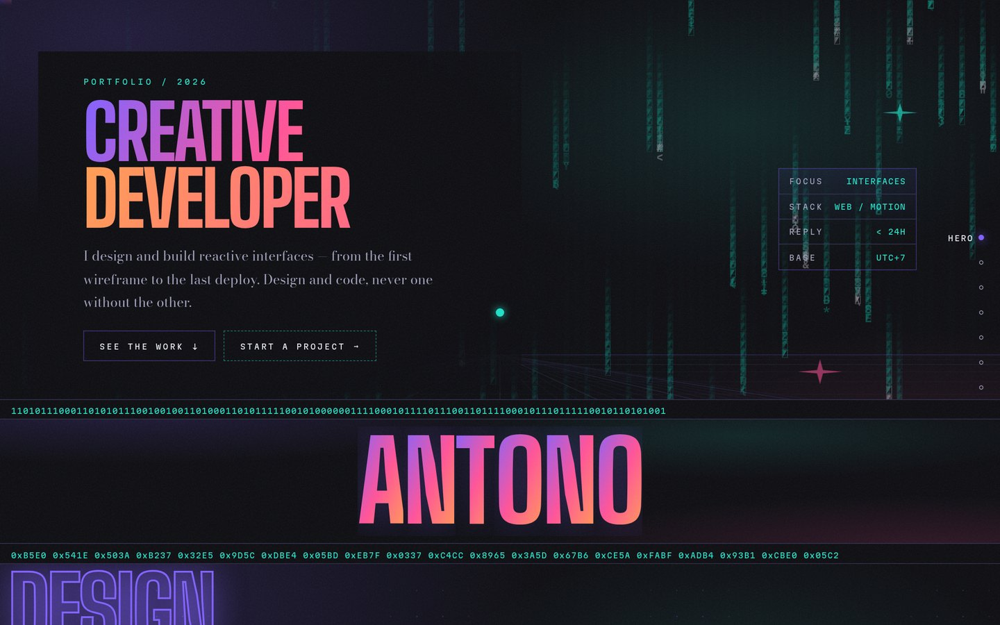
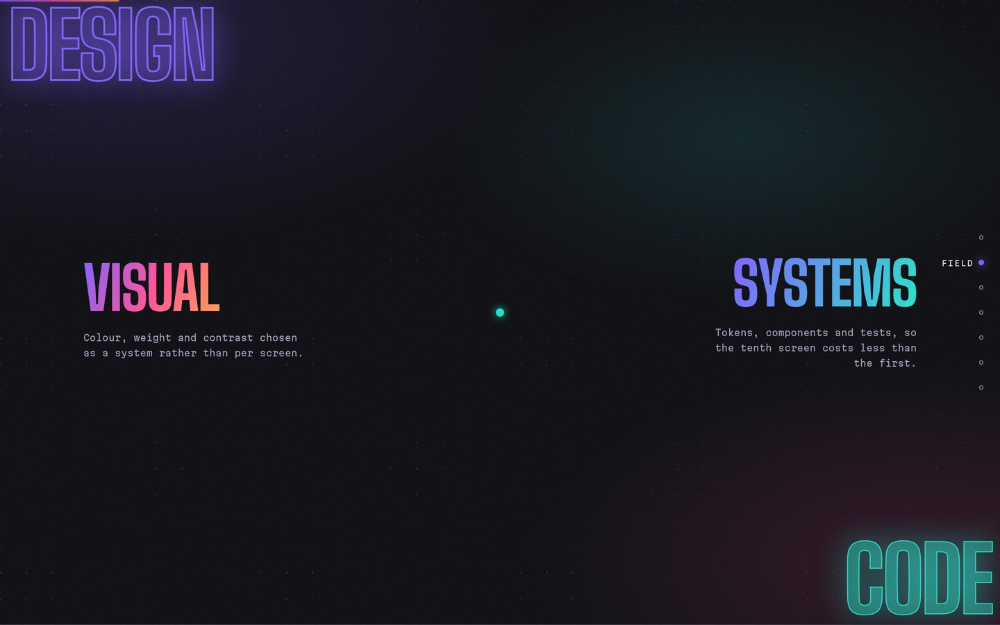
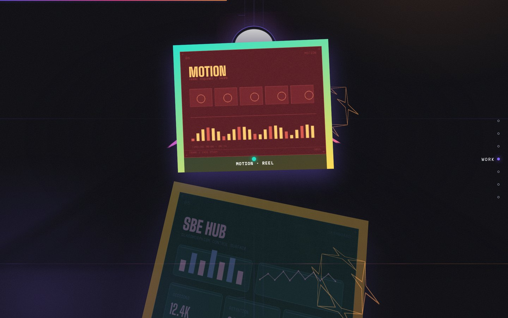
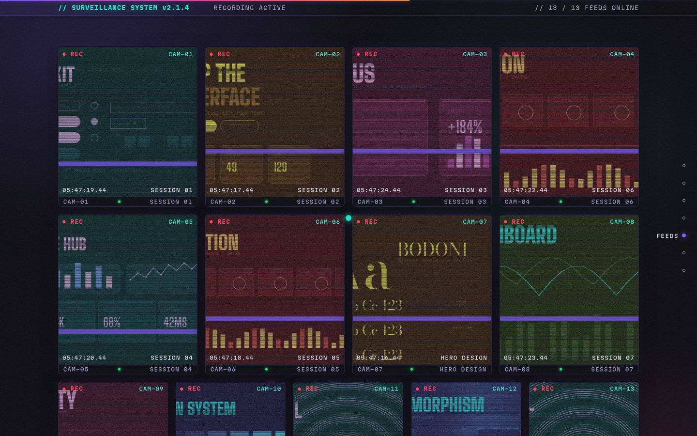
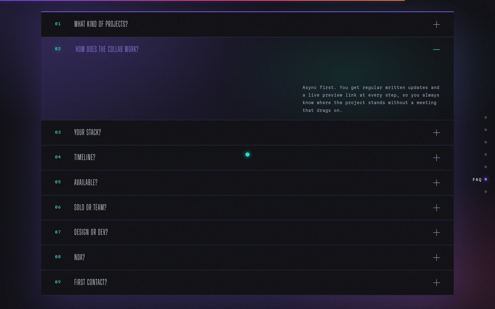
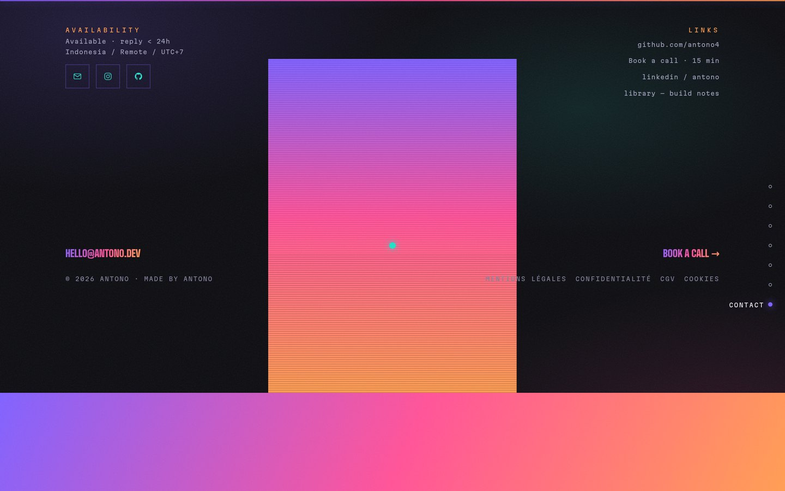
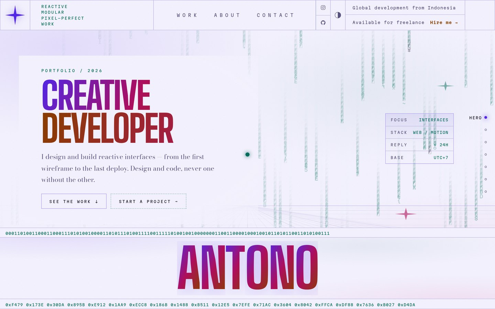
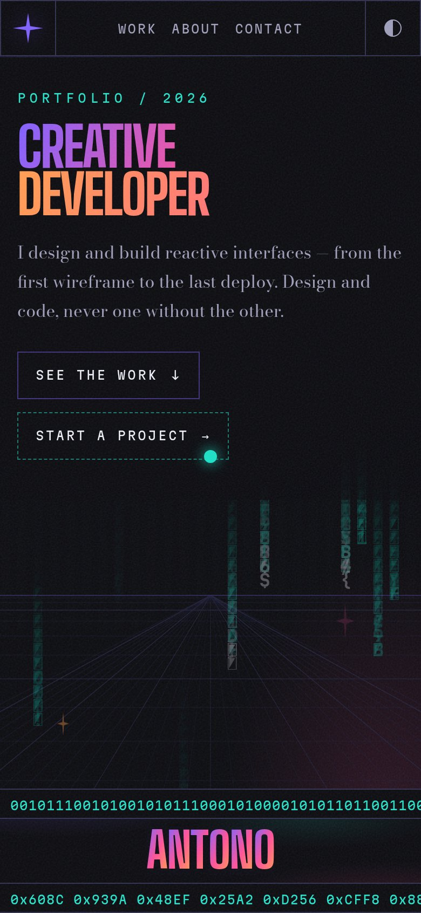

# Portfolio

A colour-driven, grid-based one-page portfolio: split-flap hero, a 3D work
gallery that travels past the camera on scroll, a thirteen-camera
"surveillance" wall, an accordion FAQ pinned behind a sticky title, and a
contact screen with a masked silhouette and an animated fringe.



Everything is static: no framework, no build step, no dependencies. Open
`index.html` and it runs.

## The screens

Six sections, one scroll.

### Field

An interactive dot field with rotating label pairs.



### Work

A 3D gallery that travels past the camera on scroll. Drag to inspect a card.



### Feeds

Thirteen monitors that decode their loop only while they are near the viewport.



### FAQ

An accordion pinned behind a sticky title. One answer opens at a time.



### Contact

A masked silhouette, the big mail link, and an animated fringe.



## Theming

Every colour is a token, so the toggle swaps the whole page and fires a short
chromatic glitch over the transition. Nothing else changes between the themes.



## Narrow widths

One gutter, one type scale, and the pinned stages fall back to normal flow when
they cannot fit. Verified from 1920px down to 360px.



## Files

```
index.html                 single page
assets/css/style.css       all styles (design tokens at the top)
assets/js/
  data.js                  shared helpers plus the WORK / MONITORS / FAQ content
  intro.js                 boot overlay: particle star, then the split
  chrome.js                custom cursor, theme glitch, nav logo, hero grid
  matrix.js                hero matrix rain (token-coloured, theme aware)
  field.js                 interactive dot field and the rotating label pairs
  bio.js                   schematic lines and card parallax
  gallery.js               3D work gallery, drag to inspect
  videos.js                monitor wall, lazy decode, live timestamps
  faq.js                   accordion plus the pinned rail
assets/fonts/              Big Shoulders Display, Bodoni Moda, Martian Mono (SIL OFL)
assets/works/              12 gallery images, 13 poster frames, 13 loop videos
assets/images/             ghost icon, QR code, contact masks
docs/                      the screenshots above
tools/make_assets.py       regenerates every file in assets/
```

## Content

Copy lives in `assets/js/data.js`. The `WORK` array drives the gallery, the
`MONITORS` array drives the camera wall, and `FAQ` drives the accordion, so all
three can be re-ordered or extended without touching markup.

## Regenerating assets

The artwork, poster frames and loop videos are generated, not photographed:

```bash
pip install pillow numpy qrcode imageio-ffmpeg
python3 tools/make_assets.py
```

The script downloads the drawing fonts into `tools/.fonts/` on first run and
writes the whole of `assets/`. Editing the drawing functions in
`tools/make_assets.py` is the way to change the visual direction of the
gallery and the monitor wall.

## Layout and spacing

Everything shares one gutter. `--pad-inline` is
`max(--gutter, (100% - --maxw) / 2)`, and every full-bleed section uses it, so
sections either line up with the grid or are deliberately edge-to-edge. Spacing
runs on a 4px scale (`--sp-1` … `--sp-10`) and type on a small scale
(`--fs-2xs` … `--fs-lg`).

`--fs-2xs` is 11px and is the floor: the labels used to render at 6px, which is
unreadable rather than merely small. Anything that needs to be smaller at a
narrow width gets a different clamp, not a smaller floor.

## Effects

`effects.js` adds three things, all additive:

- a reveal on enter for the hero copy, the field blocks and the bio, staggered
  by sibling. It animates the standalone `translate` property rather than
  `transform`, so it composes with the transforms the gallery, bio and contact
  modules already drive.
- a scroll progress rule.
- a section index, hidden below 1024px, that marks the section nearest the
  middle of the viewport — which keeps working across the pinned FAQ and
  contact stages.

Two guards matter here. The hidden state is gated on a `.js` class set before
first paint, so the copy is still visible if the script never runs. And a jump
down the page can carry the viewport past an element without it ever
intersecting, so anything already above the fold is revealed outright.

## Colour

Everything is driven by tokens at the top of `assets/css/style.css`. Five
accents — violet, teal, amber, magenta and yellow — sit on a deep indigo base,
with three gradients (`--grad-brand`, `--grad-cool`, `--grad-warm`) reused
across the hero title, the banner, the buttons and the contact silhouette. A
few tokens also carry `--rgb-*` channel triplets, which lets `rgba()` tint an
accent for glows, borders and translucent fills without a second token.

Two places deliberately do not follow the page theme, because they sit on top
of something that is dark either way: the monitor HUD text and the bezel
labels over the video wall keep a light ink in both themes.

## Notes

- The theme toggle swaps the tokens and fires a short chromatic glitch over
  the transition. The `@property` registrations make that swap interpolate
  instead of snapping.
- Motion respects `prefers-reduced-motion`: the loader, grain, orbit, dot
  field and the hero matrix rain all settle to their resting state.
- The FAQ rail is pinned inside a sticky stage and panned by scroll. The stage is
  only as tall as the rail can use: a sticky element taller than the viewport can
  never reveal its own bottom, so when the rail cannot fit, `faq.js` drops the
  pin and the rail flows normally instead. Otherwise the first and last questions
  would be unreachable.
- The hero matrix rain is drawn in the accent tokens rather than green, so it
  works in both themes. The hero grid and the rain are dimmed only where the
  headline sits: a soft field anchored to `.Hero_left`, because the headline
  covers anywhere from 47% to 96% of the viewport as the layout reflows.
- Monitors only decode their loop while they are near the viewport, and
  everything pauses when the tab is hidden.
- The intro and dot-field canvases read their colours from the same CSS tokens
  at draw time, so they follow the active theme.
- Two places need ink that ignores the theme because what is behind them does
  not follow it: the drifting gallery title sits over saturated artwork, so it
  carries a dark scrim, and the gallery card captions sit on per-card gradients,
  so they carry their own dark band. Neither can be solved with a token, since
  the background is arbitrary.
- The mockups and monitor loops are drawn in greyscale and then mapped onto a
  per-work accent pair by `duotone()` in `tools/make_assets.py`. The mapping
  keeps each drawing's own luminance and only takes the colour from the ramp;
  a plain colour-map flattens these mostly-solid panels into single hues.
- The screenshots in `docs/` are rendered from this page by Playwright at
  1440x900, so they go stale if the layout changes. Re-shoot them rather than
  editing them.
